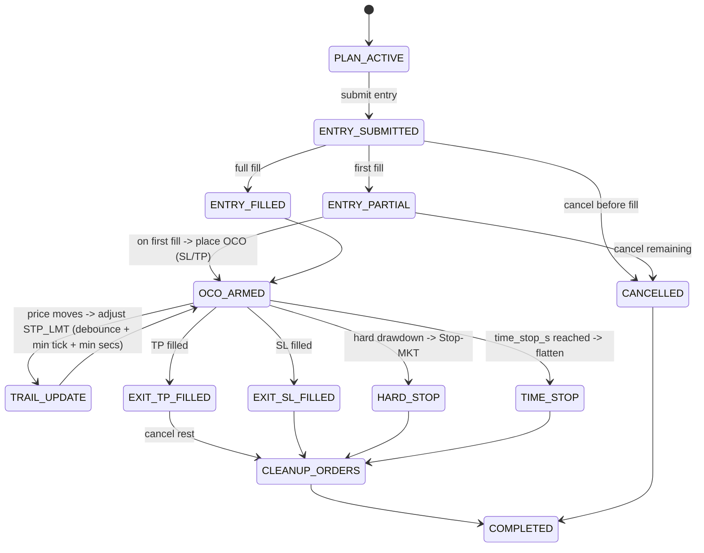

太棒，那我就把“安全内核（Safety Core）”的**工程级规范**直接贴出来：
包含 **PostgreSQL 表结构（DDL）**、**资金预留与下单的原子事务流程**、**执行/OCO与止损状态机**、**冷启动对账算法**、**Kill-Switch 与 Pre-flight 检查**、**关键监控指标**。
这份落地后，你就能在“只平仓 / 小资金灰度”下安全跑 5s 策略，同时与我们已经拍板的 ClickHouse 数据层完美衔接。

---

# 1) PostgreSQL（交易与风控账本）DDL

> 命名空间：`core_` 前缀；所有时间戳存 **UTC**；金额/价格用 `NUMERIC(18,6)`（或你们统一的小数位）；
> 所有**副作用动作**（下单、审批、释放）都有审计字段与幂等键。

```sql
-- 策略主表（可选，便于元数据与额度管理）
CREATE TABLE core_strategy (
  strategy_id        TEXT PRIMARY KEY,
  name               TEXT NOT NULL,
  capital_limit_usd  NUMERIC(18,2) NOT NULL DEFAULT 0,
  created_at         TIMESTAMPTZ NOT NULL DEFAULT now(),
  updated_at         TIMESTAMPTZ NOT NULL DEFAULT now()
);

-- 资金账本（每策略一行，预留与实现盈亏等），实时状态表
CREATE TABLE core_strategy_ledger (
  strategy_id        TEXT PRIMARY KEY REFERENCES core_strategy(strategy_id) ON DELETE CASCADE,
  reserved_usd       NUMERIC(18,2) NOT NULL DEFAULT 0,         -- 订单级资金预留的合计
  realized_pnl_usd   NUMERIC(18,2) NOT NULL DEFAULT 0,         -- 已实现盈亏
  buffer_ratio       NUMERIC(6,4)  NOT NULL DEFAULT 0.0010,    -- 资金缓冲比例（如 0.1%）
  updated_at         TIMESTAMPTZ   NOT NULL DEFAULT now(),
  version            BIGINT        NOT NULL DEFAULT 0          -- 乐观并发控制（可选）
);

-- 订单级资金预留（审批通过即写入；订单终态释放）
CREATE TABLE core_order_reservation (
  reservation_id     UUID PRIMARY KEY,
  strategy_id        TEXT NOT NULL REFERENCES core_strategy(strategy_id),
  symbol             TEXT NOT NULL,
  notional_usd       NUMERIC(18,2) NOT NULL,                   -- 预计名义额
  buffer_bps         INTEGER NOT NULL DEFAULT 10,              -- 滑点+佣金缓冲（bps）
  reserved_usd       NUMERIC(18,2) NOT NULL,                   -- 真正预留 = notional*(1+buffer_bps/10000)
  status             TEXT NOT NULL CHECK (status IN ('RESERVED','RELEASED','CANCELLED')),
  reason             TEXT,                                     -- 释放/取消原因
  order_id           UUID,                                     -- 对应订单（下单后回填）
  idempotency_key    TEXT NOT NULL,                            -- 幂等键（订单请求维度）
  created_at         TIMESTAMPTZ NOT NULL DEFAULT now(),
  released_at        TIMESTAMPTZ,
  UNIQUE (idempotency_key)
);

-- 订单主表（Execution Service 写入；幂等键唯一）
CREATE TABLE core_order (
  order_id           UUID PRIMARY KEY,
  strategy_id        TEXT NOT NULL REFERENCES core_strategy(strategy_id),
  symbol             TEXT NOT NULL,
  side               TEXT NOT NULL CHECK (side IN ('BUY','SELL')),
  order_type         TEXT NOT NULL CHECK (order_type IN ('MKT','LMT','STP','STP_LMT')),
  qty                NUMERIC(18,6) NOT NULL,
  limit_px           NUMERIC(18,6),
  stop_px            NUMERIC(18,6),
  tif                TEXT,                                     -- DAY/IOC/FOK/GTC...
  state              TEXT NOT NULL,                            -- NEW/SUBMITTED/PARTIAL/FILLED/CANCELLED/REJECTED
  parent_order_id    UUID,                                     -- 子单/OCO关联
  oca_group          TEXT,                                     -- OCO/OCA 组号
  order_ref          TEXT,                                     -- 我方 orderRef（用于对账）
  broker_order_id    TEXT,                                     -- IB 订单 id（本地）
  ib_perm_id         BIGINT,                                   -- IB permId（跨会话不变）
  idempotency_key    TEXT NOT NULL,
  note               TEXT,
  submitted_at       TIMESTAMPTZ,                              -- 发送到 IB 的时间
  last_update_at     TIMESTAMPTZ NOT NULL DEFAULT now(),
  UNIQUE (idempotency_key),
  INDEX_core_order_strategy_symbol_state_idx
);

CREATE INDEX INDEX_core_order_strategy_symbol_state_idx
  ON core_order(strategy_id, symbol, state);

-- 成交（去重索引，避免重复 Fill）
CREATE TABLE core_fill (
  fill_id            UUID PRIMARY KEY,
  order_id           UUID NOT NULL REFERENCES core_order(order_id) ON DELETE CASCADE,
  ts                 TIMESTAMPTZ NOT NULL,
  qty                NUMERIC(18,6) NOT NULL,
  px                 NUMERIC(18,6) NOT NULL,
  liquidity          TEXT,                                     -- ADD/REMOVE/UNKNOWN
  commission_usd     NUMERIC(18,6) DEFAULT 0,
  exchange           TEXT,
  exec_id            TEXT,                                     -- 券商执行id（如有）
  UNIQUE (order_id, ts, qty, px)                               -- 去重关键
);

-- 持仓（按策略×symbol 聚合净仓）
CREATE TABLE core_position (
  strategy_id        TEXT NOT NULL REFERENCES core_strategy(strategy_id),
  symbol             TEXT NOT NULL,
  pos_qty            NUMERIC(18,6) NOT NULL DEFAULT 0,         -- 有符号净仓
  avg_px             NUMERIC(18,6),                            -- 加权均价（净仓=0时可置NULL）
  realized_today_usd NUMERIC(18,6) NOT NULL DEFAULT 0,
  updated_at         TIMESTAMPTZ NOT NULL DEFAULT now(),
  PRIMARY KEY (strategy_id, symbol)
);

-- 风控事件/审批审计（可选）
CREATE TABLE core_risk_event (
  id                 UUID PRIMARY KEY,
  ts                 TIMESTAMPTZ NOT NULL DEFAULT now(),
  strategy_id        TEXT,
  symbol             TEXT,
  kind               TEXT,                                     -- APPROVE/DENY/PAUSE/RESUME...
  reason             TEXT,
  payload            JSONB
);

-- 对账日志
CREATE TABLE core_reconcile_log (
  id                 UUID PRIMARY KEY,
  ts                 TIMESTAMPTZ NOT NULL DEFAULT now(),
  action             TEXT NOT NULL,                            -- ADOPT_ORPHAN / CLOSE_GHOST / REBUILD_CTX ...
  strategy_id        TEXT,
  symbol             TEXT,
  order_id           UUID,
  broker_order_id    TEXT,
  ib_perm_id         BIGINT,
  details            JSONB,
  status             TEXT NOT NULL CHECK (status IN ('SUCCESS','SKIPPED','FAILED'))
);

-- 健康与控制（心跳/模式）
CREATE TABLE core_health (
  component          TEXT PRIMARY KEY,                         -- ib,tws,kafka,clickhouse,engine,exec,risk,data...
  status             TEXT NOT NULL CHECK (status IN ('UP','DOWN','DEGRADED')),
  last_heartbeat     TIMESTAMPTZ NOT NULL DEFAULT now(),
  details            JSONB
);

CREATE TABLE core_control_state (
  key                TEXT PRIMARY KEY,                         -- trading_mode, halt_reason ...
  value              TEXT NOT NULL,
  updated_at         TIMESTAMPTZ NOT NULL DEFAULT now()
);
```

> 索引与约束要点
>
> * `core_order.idempotency_key` 唯一：**防重复下单**
> * `core_fill` 的 `(order_id, ts, qty, px)` 唯一：**防重复填充**
> * `core_order_reservation.idempotency_key` 唯一：**防重复预留**
> * `core_position` 以 `(strategy_id, symbol)` 为主键：快速更新净仓/均价

---

# 2) “审批→预留→下单→释放”原子流程（带 PG 咨询锁）

> 核心：**审批/预留**必须在**同一事务**内，并使用 **PG Advisory Lock** 把“策略×symbol”串行化，防止并发冲关。

## 2.1 审批与预留（Risk Service）

```sql
-- 计算锁ID：可用 hash(strateg_id || ':' || symbol) 取 64bit
-- 语言层面：SELECT pg_try_advisory_xact_lock(lock_id);
BEGIN;

SELECT pg_try_advisory_xact_lock(:lock_id) AS got;
-- 若 got=false → 立即返回"RETRY_LATER"或排队等锁（看你策略）

-- 1) 读取资金池与风险边界
SELECT capital_limit_usd, reserved_usd, buffer_ratio
FROM core_strategy s
JOIN core_strategy_ledger l USING(strategy_id)
WHERE s.strategy_id = :sid
FOR UPDATE;  -- 可选

-- 2) 计算本单预留：notional*(1+buffer_ratio) 或 buffer_bps
-- 校验集中度/板块暴露/黑名单/时窗等（附上理由）

-- 3) 更新 ledger.reserved_usd（加法）
UPDATE core_strategy_ledger
SET reserved_usd = reserved_usd + :reserve_usd, updated_at = now(), version = version + 1
WHERE strategy_id = :sid;

-- 4) 插入 reservation（幂等）
INSERT INTO core_order_reservation(reservation_id, strategy_id, symbol, notional_usd,
  buffer_bps, reserved_usd, status, idempotency_key)
VALUES(:rid, :sid, :sym, :notional, :buffer_bps, :reserve_usd, 'RESERVED', :idem)
ON CONFLICT (idempotency_key) DO NOTHING;

COMMIT;
-- 返回 APPROVED + reservation_id
```

> 失败路径
>
> * 资金不足/集中度超限 → `DENY(reason)`（不写 reservation）
> * 并发锁抢不到 → 返回 `RETRY_LATER`（引擎重试/排队）

## 2.2 下单与幂等写入（Execution Service）

```sql
-- 订单幂等写入（先本地DB记录再发券商）
INSERT INTO core_order(order_id, strategy_id, symbol, side, order_type, qty, limit_px, stop_px,
  tif, state, parent_order_id, oca_group, order_ref, idempotency_key, submitted_at)
VALUES(:oid, :sid, :sym, :side, :type, :qty, :lpx, :spx, :tif, 'SUBMITTED', :parent, :oca, :oref, :idem, now())
ON CONFLICT (idempotency_key) DO UPDATE
  SET last_update_at = now()
RETURNING order_id;
-- 然后与 IB 交互，拿到 broker_order_id/permId 回写
UPDATE core_order SET broker_order_id=:boid, ib_perm_id=:permId, last_update_at=now() WHERE order_id=:oid;
-- 首笔 Fill 到来 → 立即派生并挂 OCO（止损/止盈），同样以幂等键写入 core_order
```

## 2.3 终态释放（Filled / Cancelled / Rejected）

```sql
BEGIN;
-- 1) 更新订单状态
UPDATE core_order SET state = :terminal_state, last_update_at = now() WHERE order_id = :oid;

-- 2) 释放 reservation（按幂等键找）
UPDATE core_order_reservation
SET status='RELEASED', released_at=now(), reason=:reason, order_id=:oid
WHERE idempotency_key=:idem AND status='RESERVED';

-- 3) 更新 ledger.reserved_usd（减法）
UPDATE core_strategy_ledger
SET reserved_usd = GREATEST(reserved_usd - :reserve_usd, 0), updated_at = now(), version = version + 1
WHERE strategy_id = :sid;

COMMIT;
```

> 说明
>
> * **部分成交**：可以不即时释放，待订单终态一次性释放（简单且安全）。需要更细腻可按“剩余未成交名义额”动态回收。
> * **OCO 单**：作为**保护单**，不占用额外预留（关闭风险），但下单时仍走风控审批（速度通道），不修改资金池。

---

# 3) 执行/OCO/止损状态机（Mermaid）



**硬性护栏（执行器参数）**

* `min_modify_secs`（最小改价间隔）
* `min_price_step_ticks`（最小价步）
* `max_price_updates_per_min`（撤改限速）
* `stop.hard_kill_pct`（灾难硬停触发）
* `stop.trailing.{atr_k, min_step_ticks, min_modify_secs}`
* `time_stop_s`（time-stop 秒级）

**订单巡检协程**

* 每 3–5s：

  * “应取消未取消”的入场单/保护单 → 强制撤单
  * OCO 双挂检查（缺一补一）
  * 保护价是否偏离过大 → 纠偏或升级市价

---

# 4) 冷启动对账（Reconciliation 2.0）

**目标**：重启后 ≤ **5 分钟**恢复到“可交易状态”，无“幽灵单”，所有实挂单均被领养并恢复 OCO 保护。

**流程**

1. **拉取 IB 实盘挂单**（含 `permId`, 合约, 方向, 价格, 数量, 状态）
2. **匹配顺序**：

   * A. 精确：按 `permId` ↔ `core_order.ib_perm_id`
   * B. 半精确：`order_ref` ↔ `core_order.order_ref`
   * C. 模糊：合约+方向+价差≤阈值（bps）+时间窗≤X 分钟
3. **孤儿领养**：

   * 未匹配到本地的实挂单 → 新建 `core_order`（状态=SUBMITTED），补充 `permId/broker_id/oca_group`，并建立父子/OCO关系
4. **幽灵清理**：

   * DB 中存在但 IB 不存在的活跃单 → 标记 `state=CANCELLED` + 记录 `core_reconcile_log`
5. **上下文重建**：

   * 重建 `order_map`、净仓/均价（回放 `core_fill` 或从 IB 拉持仓比对）
   * 若仓位与保护单不一致 → 立刻补挂 OCO（以 Stop-MKT 为兜底）
6. **安全阈**：

   * `price_tolerance_bps`（如 5–20bps）、`adopt_window_min`（如 15 分钟）、`max_actions_on_start`（如 500）
7. **审计**：对每个动作写 `core_reconcile_log`，失败项明确原因（权限/数据缺失/价格偏离过大等）

---

# 5) Kill-Switch 与 Pre-flight（启动阻塞）

**Pre-flight（run 前必须通过）**

* PG：读/写自检（事务 + 索引存在 + 行锁测试）
* ClickHouse：入库可用、自检查询通过
* Kafka：生产/消费连通，主题存在 & 最小滞后
* IBKR：连接 + 订阅最小合约 + 心跳
* 配置：参数校验（`param_registry` 守门；危险参数落在保护区外直接拒绝启动）
* **任一失败 → 拒绝启动**（写入 `core_health`，发告警）

**Kill-Switch（运行中）**

* 触发条件：心跳丢失（N 次）、IB 断线>阈值、Kafka/CH 延迟>阈、执行/OCO 安全检查失败
* 行为：设置 `core_control_state(trading_mode='FLATTEN_ONLY')`，执行器只允许平仓，不下新单；控制台可**人工解锁**（审计）

---

# 6) 关键指标与验收门槛（Safety Core）

**执行安全**

* `order.oco_attach_success_rate` = 100%
* `order.unprotected_window_seconds` = 0（任何单）
* `order.stoplimit_to_market_upgrade_total`（分策略/分symbol）

**风控一致性**

* `ledger.reserved_vs_release_diff_usd`（应为 0）
* `risk.approval_latency_ms`（p95）
* `pg.advisory_lock_wait_ms`（p95）

**对账恢复**

* `reconcile.orphans_adopted_total` / `ghosts_closed_total`
* `reconcile.restore_time_seconds` ≤ 300

**健康/熔断**

* `preflight.result=PASS` 才允许交易
* `killswitch.triggers_total`（若>0，必须有审计与Runbook记录）

---

# 7) 与 ClickHouse/5s 策略的衔接（最小竖切）

* **数据侧**已经确定：`md.bar.5s.v2`（Kafka→CH），策略引擎订阅该主题即可；
* **安全内核**优先上线后，开放 **Per-Strategy 5s 调度**（已给出调度伪代码），保证“安全→快”。

---

## 你可以现在让工程开工的分工清单

* **DB 工程**：按上面的 DDL 建表 + 索引；写 3 个存储过程/函数（可选）：

  * `fn_hash_lock_id(strategy_id, symbol)` → 64bit
  * `sp_risk_approve_and_reserve()` → 封装 2.1 流程
  * `sp_release_reservation_on_terminal()` → 封装 2.3 流程
* **Risk Service**：实现“审批→预留” API（进程内或事件应答），内置 `pg_try_advisory_xact_lock`；
* **Execution Service**：执行状态机 + OCO 即时保护 + 巡检协程 + 幂等写入；
* **Reconciliation**：实现 4) 的 7 步；
* **Control/Dashboard**：Pre-flight、Kill-Switch、审计面板与只读状态页；
* **Observability**：把 6) 的指标挂上 Prometheus/Grafana（或你们的替代方案）。

---
