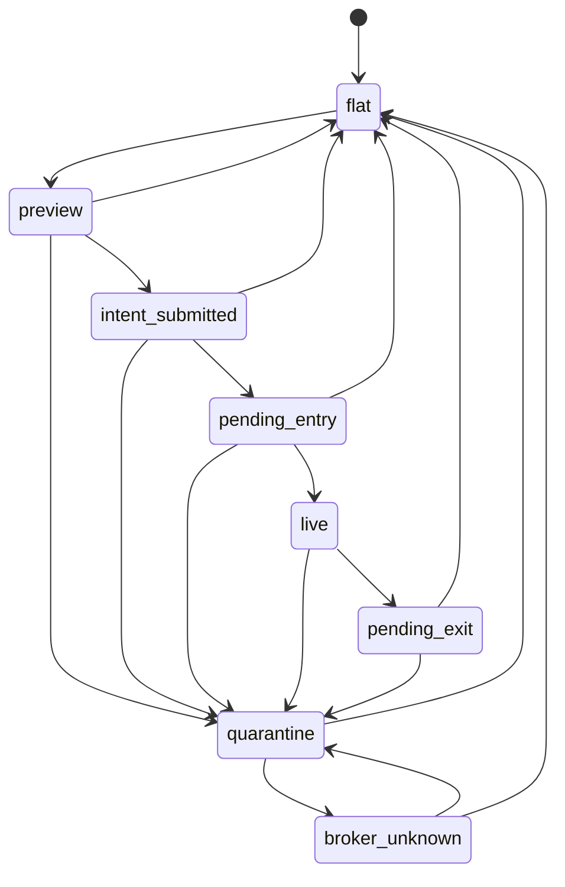
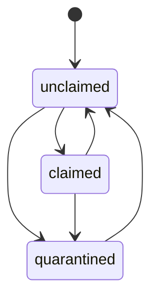

# INDEX_SUPER_WIN_V2_RUNTIME_SCHEMA

## 1. 目标

本文件定义 `index_super_win v2` 的运行态 schema 和 ownership 状态机。

要求：

1. 不影响现有 `qqq_intraday_001`
2. 不复用旧策略类内状态作为最终真相
3. 不允许 broker live position 被新策略直接“认仓”

## 2. 真相顺序

统一真相顺序：

1. Broker snapshot
2. DB order ledger
3. Runtime store
4. Strategy local memory

策略本地内存永远不是最终真相源。

## 3. Runtime State Schema

`RuntimeState` 字段：

- `strategy_id`
- `symbol`
- `lifecycle`
- `target_qty`
- `live_qty`
- `broker_qty`
- `side`
- `active_trigger_id`
- `ownership_token`
- `entry_order_ref`
- `protective_order_refs`
- `quarantine_reason`
- `last_error`
- `last_synced_at_us`
- `updated_at_us`

### 3.1 lifecycle 定义

- `flat`
- `preview`
- `intent_submitted`
- `pending_entry`
- `live`
- `pending_exit`
- `quarantine`
- `broker_unknown`

## 4. Ownership Schema

`OwnershipRecord` 字段：

- `symbol`
- `state`
- `owner_strategy_id`
- `claimed_qty`
- `trigger_id`
- `order_namespace`
- `broker_qty`
- `quarantine_reason`
- `acquired_at_us`
- `updated_at_us`

### 4.1 ownership state 定义

- `unclaimed`
- `claimed`
- `quarantined`

## 5. 允许的状态流转

### 5.1 Runtime lifecycle

### 5.2 Ownership lifecycle

## 6. 关键约束

### 6.1 不允许的行为

- `preview` 阶段 claim ownership
- `preview` 阶段写入持久 `pending_entry`
- `intent_submitted` 仅因 pipeline approved 就 claim ownership
- `pending_entry` 仅因 pipeline approved 就进入 `live`
- `flat` 状态下直接认领 broker 非零仓位
- 通过单次 entry 覆盖反向 broker 仓位
- 复用 `qqqv1` order namespace

### 6.2 允许的行为

- broker 有仓但 ownership 不明时进入 `quarantine`
- 启动时发现 broker 非零仓位且 runtime 无 `intent_submitted` 时进入 `quarantine`
- 仅当 runtime 已处于 `intent_submitted/pending_entry` 且 broker 确认非零仓位时，才允许转为 `live`
- broker 有单但 DB 终态时由 reconciler 清理
- protective stop 缺失时通过共享保护层补单

## 7. 新命名空间

新 `order_ref` 协议：

- `iswv2:{strategy_id}:{symbol}:{kind}:TRG:{trigger}`

示例：

- `iswv2:index_super_win_001:AAPL:ENTRY:TRG:abc123def4567890`
- `iswv2:index_super_win_001:AAPL:STOP:TRG:abc123def4567890:1`

## 8. Phase 1 落地范围

本阶段只实现以下内容：

1. `RuntimeState`
2. `InMemoryRuntimeStore`
3. `OwnershipRecord`
4. `InMemoryPositionOwnershipService`
5. `order_identity`
6. `BrokerSnapshotService`

本阶段不接入：

1. 现有 `qqq`
2. 现有 execution path
3. 现有 runtime reconciler 逻辑变更

## 9. 下一步

下一阶段进入：

1. `index_super_win` 策略骨架
2. coordination adapter
3. protection adapter
4. shadow 验证用例
