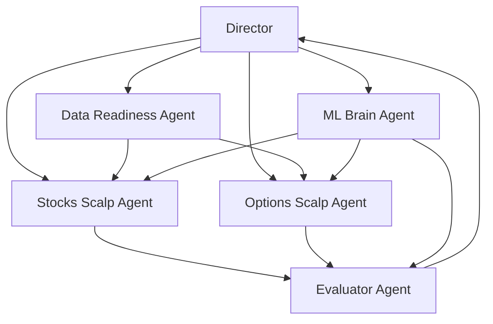

# AI Research Factory Coordination

## 1. 协调原则

作为统一协调层，Director 只做四件事：

1. 定义当天研究目标。
2. 把目标拆成子 agent 任务。
3. 回收所有 `AgentReport`。
4. 交给 Evaluator 做统一排序和晋级建议。

Director 不直接实现特征、不直接写策略、不直接跑回测。

## 2. 每日运行节奏

### Stage A: Intake

- 读取市场、数据、ML、历史研究快照。
- 形成 `ResearchCycleSpec`。

### Stage B: Task Split

- 先问 Data Readiness 是否可跑。
- 再把研究预算分配给 ML / Stocks / Options。

### Stage C: Execute

- 各 agent 提交 `ExperimentSpec`。
- adapter 执行实验。

### Stage D: Robustness

- 所有实验先通过 `RobustnessAdapter`。
- walk-forward、leakage、regime stability、cross-symbol transfer 在这里统一落盘。

### Stage E: Evaluate

- Evaluator 统一读取 `ExperimentResult`。
- 生成 `PromotionDecision`。

### Stage F: Portfolio Evaluate

- 对单实验 winner 做候选集组合评估。
- 输出 `PortfolioEvaluation`。

### Stage G: Persist

- 写回日报、排行榜、候选池、复盘建议。

## 3. 子 agent 数量

MVP 固定为 5 个执行子 agent：

1. Data Readiness Agent
2. ML Brain Agent
3. Stocks Scalp Agent
4. Options Scalp Agent
5. Evaluator Agent

运行时再加 1 个 Director 作为协调层，总共 6 个角色。

不建议第一期超过这个数量。

说明：

- Portfolio Layer 在 MVP 不单独拆 agent。
- 第一阶段先由 Evaluator 兼任 `PortfolioEvaluation`。

## 4. 依赖顺序

## 5. 当前开发任务分配

### Task Group 1: 协议层

Owner:
- Director / PM

任务：
- 固化 `ResearchCycleSpec`
- 固化 `AgentTask`
- 固化 `ExperimentSpec`
- 固化 `ExperimentResult`
- 固化 `AgentReport`

验收：
- 文档完成
- 各 agent 文档引用一致

### Task Group 2: Scheduler 闭环

Owner:
- Director
- Evaluator Agent

任务：
- 实现 `strategy_experiment` 执行器
- 统一实验结果落盘位置
- 给实验增加稳定 `experiment_id`
- 让实验闭环支持 robustness / execution reality / lineage 落盘

验收：
- 从 `research/orchestrator.py` 提交的 `strategy_experiment` 能真正执行到结果落盘

### Task Group 3: 股票回测接入

Owner:
- Stocks Scalp Agent

任务：
- 设计 `stocks_kernel_backtest` adapter
- 明确 template / feature / gate / risk policy 到 `ExperimentSpec` 的映射
- 补齐标准化结果输出
- 暴露 execution reality 字段

验收：
- 至少支持 `QQQ`, `SPY` 日内单标的削头皮回测

### Task Group 4: 期权回测接入

Owner:
- Options Scalp Agent

任务：
- 设计 `options_single_leg_replay` adapter
- 明确 `definition_id` 到 replay strategy 的映射
- 标准化期权 replay 输出
- 暴露 execution audit 到统一结果结构

验收：
- 至少支持 `QQQ`, `SPY` 单腿日内策略回放

### Task Group 5: ML 融合

Owner:
- ML Brain Agent

任务：
- 把 `review_ml` 输出映射为可消费的搜索空间 patch
- 约束 Brain 只能推荐注册表内可执行模块
- 让 Stocks / Options agent 能读取 ML 建议
- 让 ML Brain 同时输出 robustness evidence，而不只是 feature hints

验收：
- ML 输出能影响实验搜索空间，但不绕过协议直接操作执行引擎

### Task Group 6: Robustness 总线

Owner:
- ML Brain Agent
- Evaluator Agent

任务：
- 定义 `RobustnessAdapter`
- 把 walk-forward、embargo、leakage、regime split、cross-symbol transfer 统一接入实验闭环

验收：
- 每个实验都能输出统一 robustness 字段

### Task Group 7: 统一评估

Owner:
- Evaluator Agent

任务：
- 定义跨股票和期权的标准分数
- 加入 trade count、drawdown、coverage 等质量门槛
- 加入 complexity penalty、instability penalty、cost normalization
- 产出统一排序和晋级建议

验收：
- 同一轮里股票和期权实验可以放在一个排行榜比较

### Task Group 8: 研究层 Portfolio Evaluation

Owner:
- Evaluator Agent

任务：
- 定义候选策略组合评分
- 引入 correlation、risk contribution、drawdown overlap、diversification score

验收：
- 不是只选单 winner，而是能选候选组合

## 6. Phase 计划

### Phase 0

目标：
- 文档、接口、角色职责冻结

输出：
- 本目录下所有 PM 文档

### Phase 1

目标：
- 打通 `strategy_experiment`

输出：
- 可执行实验闭环

### Phase 2

目标：
- 接入股票 adapter

输出：
- 股票实验可运行

### Phase 3

目标：
- 接入期权 adapter

输出：
- 期权实验可运行

### Phase 4

目标：
- 接入 Evaluator 和日报

输出：
- 每日研究榜单

### Phase 5

目标：
- 接入 PortfolioEvaluation

输出：
- 单实验 winner + 候选组合建议

## 7. 管理看板

### Ready

- 统一协议设计
- 子 agent 文档
- MVP 范围冻结

### Next

- `strategy_experiment` 执行器
- 股票 adapter
- 期权 adapter
- RobustnessAdapter
- ExecutionRealityAdapter

### Later

- 真正并行调度
- 多腿期权
- 自动晋级到 shadow 或 paper
- 独立 Portfolio Manager Agent

## 8. 风险与对策

### 风险 1

子 agent 太多，实际没有协议，最后还是靠 prompt 拼接。

对策：
- 先以结构化对象交互，prompt 只负责生成受控字段。

### 风险 2

股票和期权回测结果维度不一致，无法统一评价。

对策：
- 不统一 engine，先统一 `ExperimentResult`。
- 再通过 `ExecutionRealityAdapter` 和 cost normalization 对齐。

### 风险 3

ML Brain 建议过于发散，生成无法执行的实验。

对策：
- ML Brain 只能返回 registry 内模块与参数 patch。
- robustness 证据也必须结构化返回。

### 风险 4

策略研究和生产执行混在一起，风险过高。

对策：
- 第一阶段限定在 `paper_research`，不直接联动生产执行。

### 风险 5

已有子系统能力被重复建设，形成第二套平行系统。

对策：
- 优先把现有 ML / risk / replay / memory / evolution / parity 能力接总线。

## 9. PM 当前结论

现在不应该先继续堆 prompt，也不应该先做“超级 agent”。  
应该先把协议、adapter、结果归一化做出来，再让多个 agent 在这个壳子里工作。  
真实缺口不是“没有零件”，而是“零件没有接总线”。
